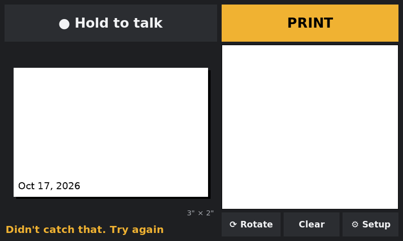
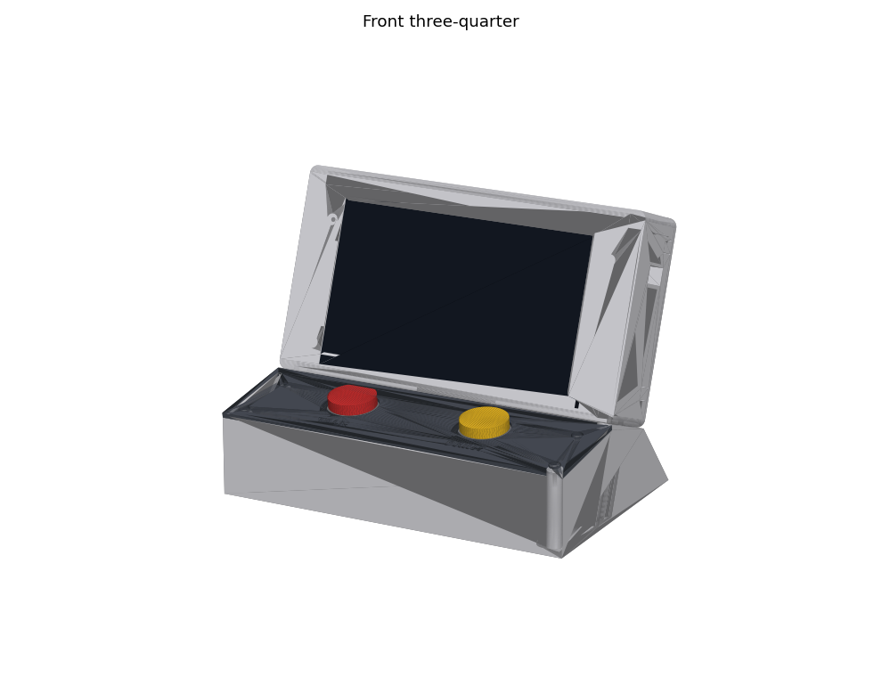

# Voice Labels

A stand-alone voice-to-label printer built on a Raspberry Pi 5. Hold **TALK** and say what the label should read. Fix any words on the keyboard or touchscreen, check the preview, then hold **PRINT** to print a 2×3" label on a Zebra thermal printer.

Speech recognition runs entirely on the Pi with [Moonshine](https://github.com/moonshine-ai/moonshine), so there's no cloud service, no fee, and no internet needed after setup.

<p align="center">
  
  
</p>

## What's here

| Folder | Contents |
|---|---|
| [`labelbox/`](labelbox/) | The app: touchscreen editor with a live label preview, push-to-talk speech, date and QR code options, Zebra ZPL printing, screen blanking, and a Setup screen. [Setup and usage guide](labelbox/README.md) |
| [`case/`](case/) | A 3D-printable desk console: the reclined screen housing, a button deck for TALK and PRINT, a side mic socket, and snap-out cable tabs. Includes print-ready STLs and the parametric Python model. [Printing and assembly guide](case/README.md) |

<p align="center">
  
</p>

## Hardware

- Raspberry Pi 5 (4 GB), 27 W USB-C supply, Active Cooler, 32 GB microSD
- Hosyond 7" DSI touchscreen, 800×480
- USB gooseneck microphone (C G CHANGEEK CGS-M1) and a 1 ft USB extension
- Two 30 mm arcade buttons with 5 V LEDs
- Zebra GK420d or GC420d direct-thermal printer (USB), 2×3" labels
- Compact wireless keyboard

## Quick start

On Raspberry Pi OS (64-bit, desktop), copy the `labelbox` folder to the Pi and run:

```
cd labelbox
bash install.sh
sudo reboot
```

The app starts full-screen after the reboot. See [labelbox/README.md](labelbox/README.md) for wiring, printer setup and settings.
