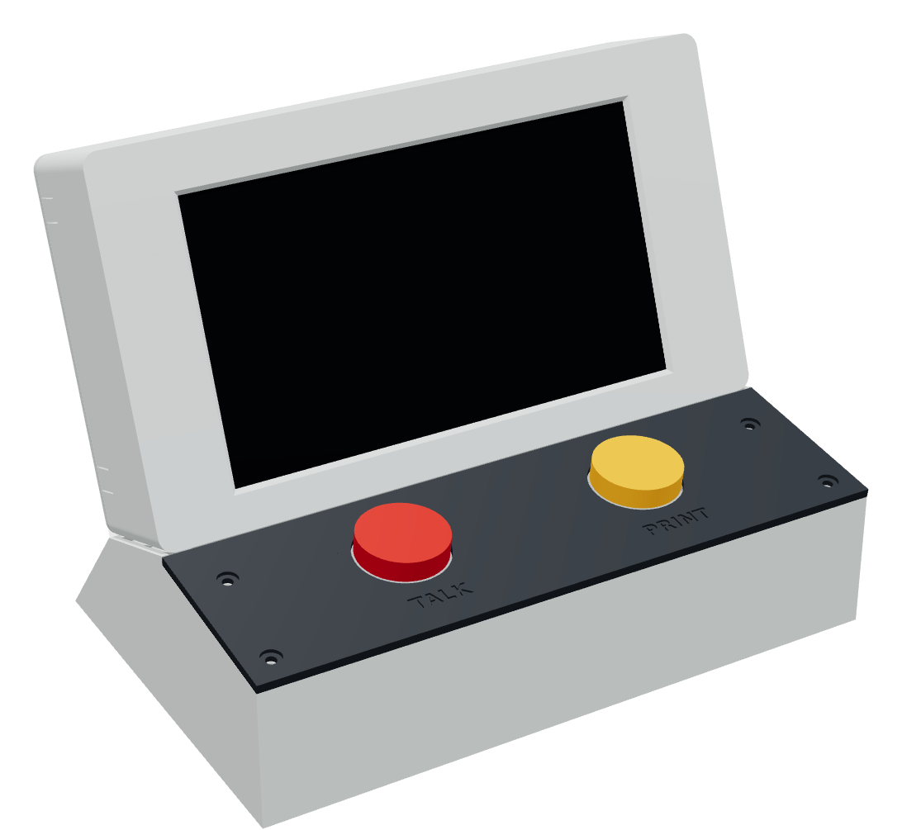
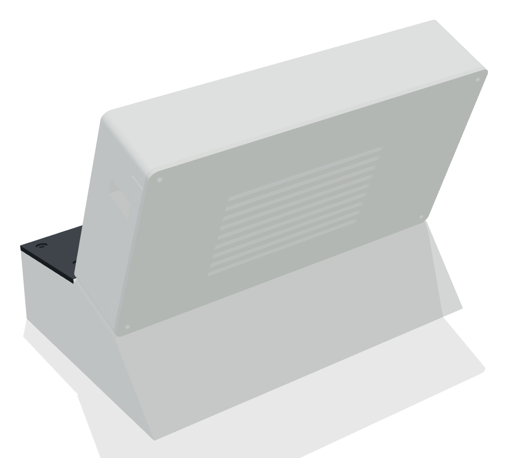

# Voice Labels case

  
  

A desk console for the voice label printer: the 7" screen (with the Pi on its back) sits in a housing reclined 20°. In front of it is a sloped deck with the **TALK** (left) and **PRINT** (right) buttons. The mic plugs into a socket on the right side, above the Pi's USB ports. Cables leave through snap-out tabs on either side.

Assembled size: about **215 W × 145 D × 170 H mm**. Every part fits the Snapmaker U1's 270 mm bed and prints **without supports**.

## Parts to print

| File | Print orientation | Size (mm) | Notes |
|---|---|---|---|
| `stl/1_housing.stl` | As exported: bezel face down | 215 × 120 × 42 | The bezel's first layers are the visible front, so use a smooth, clean plate |
| `stl/2_back_plate.stl` | Flat | 215 × 120 × 2.5 | Vents over the Pi |
| `stl/3_clamp_x4.stl` | Flat | four tabs | Hold the screen board in the housing |
| `stl/4_base.stl` | As exported: floor down | 215 × 140 × 58 | Use a brim if the corners lift |
| `stl/5_deck.stl` | As exported: top face down | 215 × 63 × 3 | TALK and PRINT are engraved 0.6 mm deep. Fill with a second colour on the U1, or paint. Around each button hole the plate is thinned to 2 mm from underneath so the buttons' snap-in clips can grip |

Suggested settings: PLA or PETG, 0.4 mm nozzle, 0.2 mm layers, 3 walls, 15–20% gyroid infill, no supports.

## Hardware

| Qty | Item | Used for |
|---|---|---|
| 8 | M3 × 10 mm pan or button head screws | Back plate (4), deck (4) |
| 4 | M3 × 8 mm | Screen clamps |
| 4 | M3 × 16 mm | Housing to base (from underneath) |
| 4 | Rubber feet, up to 13 mm across | Recesses in the base floor |
| 1 | 1 ft USB extension cable (already on the shopping list) | Pi to the mic socket |

The screws thread straight into printed pilot holes. Don't overtighten them.

## Assembly

1. **Test the fit first.** Print the deck and push a button into one hole. Check that the end of the USB extension cable slides snugly into the mic socket in the housing's right wall. If the holes are tight or loose, see Adjusting below.
2. **Snap out cable tabs.** The housing has four tabs on its back edge, a high and a low one on each side. Snap out the ones you need with pliers: a high tab for the power cable on whichever side you prefer, and the low tab on the right side for the printer cable.
3. **Join the housing to the base.** Set the housing on the base's sloped seat, with its bezel edge against the back of the deck opening. From underneath, drive the four M3 × 16 screws up through the slanted holes in the base into the housing.
4. **Fit the buttons.** Push each button down through its hole from the top until its clips snap under the plate (TALK on the left, PRINT on the right). If your buttons came with a plastic nut instead, screw it on from underneath; the thinned area leaves room for it. Wire them as described in the main README ("Wiring the buttons"). Pass the wires up through the slot in the housing floor, then screw the deck to the base (4 × M3 × 10).
5. **Fit the screen.** Remove the black corner stands from the screen if they're still attached. Lower the screen and Pi face-first into the housing. The two side rails centre it, and the board sits on the housing floor. Screw the four clamps over the board edges (M3 × 8).
6. **Connect inside.** Connect the button wires to the GPIO header. Plug the USB extension into a Pi USB port and push its socket end into the sleeve in the right wall from inside. It should be a snug push fit; a dab of hot glue holds it if not. Coil the spare cable. Plug in the printer cable and the keyboard's receiver.
7. **Route the power cable.** Its plug points up from the top of the Pi. Bend the cable along the space above the screen to the tab you opened. A right-angle USB-C cable makes this easier.
8. **Close up.** Lay the cables in their notches and screw on the back plate (4 × M3 × 10). Stick on the feet.

## Adjusting

Everything is set by the numbers at the top of `case.py`. Ready-to-print copies are in `stl/`. To regenerate them, run `python3 case.py` with `manifold3d`, `trimesh` and `numpy` installed; it writes to `out/`. The settings you're most likely to change:

| Setting | Default | What it does |
|---|---|---|
| `BUTTON_HOLE` | 30.4 | Button hole diameter |
| `BUTTON_PANEL_T` | 2.0 | Deck thickness around each button. Raise to 3.0 for clips that need a thicker panel |
| `MIC_SIDE` | right | Which side wall holds the mic socket |
| `SOCKET_W`, `SOCKET_H` | 18 × 10 | The USB extension's socket end (width along the case depth × thickness) |
| `RECLINE` | 20 | Screen tilt back from vertical, in degrees |
| `DECK_ANGLE` | 8 | Deck slope |
| `WINDOW_MARGIN` | 1.0 | How much the screen opening exceeds the picture area |
| `SIDE_GAP`, `TOP_GAP` | 22, 12 | Room beside and above the screen for plugs and cables |
| `INNER_DEPTH` | 40 | Room behind the screen for the Pi |

`python3 preview.py` checks that the screen, Pi, plugs and mic socket clear the case. It also writes the preview images in `out/`.

## Measurements to confirm before printing the housing

- **Pi depth:** the case assumes the brass standoffs hold the Pi about 8 mm off the screen board, which leaves about 6 mm of space above the Pi's USB ports. If your standoffs are longer than 12 mm, raise `INNER_DEPTH` by the difference.
- **Socket end:** measure the USB extension's socket end and set `SOCKET_W` and `SOCKET_H`.
- **Screen opening:** it comes from the maker's drawing. The picture sits closer to the left and top edges of the glass, and the opening matches that.
