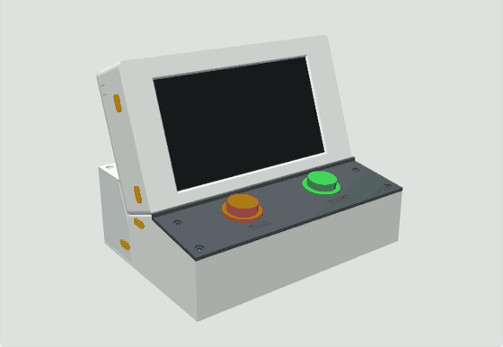
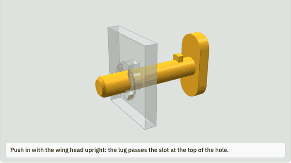
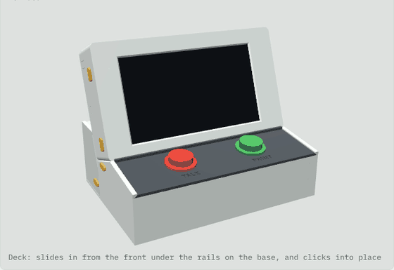

# Voice Labels case

  
  

A desk console for the voice label printer: the 7" screen (with the Pi on its back) sits in a housing reclined 20°. In front of it is a sloped deck with the **TALK** (left) and **PRINT** (right) buttons. The mic plugs straight into one of the Pi's USB ports through a tall opening in the right side wall. Cables leave through snap-out tabs on either side. Behind the base, tucked under the screen's lean, a closed **power pod** holds the USB power brick, with a switched, fused mains socket in its back wall. A 30 mm round hole on the right side joins the pod to the space under the buttons, for cables.

The big parts join with **sliding dovetails**, not screws: the screen housing slides down into slots in the base, and the power pod drops onto rails on the back of the base. Quarter-turn **lock pins** hold them there: a twist of the pin's wing head locks or frees it. The back plate, the pod lid and the button deck are **sliding panels** that click into place, and the power socket is clamped by a printed frame held by two more pins. There are no screws anywhere.

Assembled size: about **215 W × 161 D × 173 H mm**. Every part fits the Snapmaker U1's 270 mm bed and prints **without supports**.

## 3D viewer

**[Open the 3D viewer](https://scottyates.github.io/VoiceLabels/)**: turn the case, zoom, see through the shell, and take it apart by clicking. Click a pin to turn it and pull it out (click again to push it in and lock it), a panel to slide it off or on, a button to press it, and the housing, screen or pod to take it off once whatever holds it is out of the way; the viewer tells you what has to come off first. **Put it all back** reassembles it. You can also spread the parts apart, or tap **Slide the panels** to watch the deck, back plate and pod lid slide out of their rails and back in. Below the model, an animated close-up shows how the quarter-turn pins lock.

  
  

The viewer is one self-contained file, [`viewer/index.html`](viewer/index.html), with the model built in, so you can also download it and open it in any web browser. The hosted copy lives on the `gh-pages` branch; after changing the viewer, copy it there as `index.html` to update the link.

## Parts to print

| File | Print orientation | Size (mm) | Notes |
|---|---|---|---|
| `stl/1_housing.stl` | As exported: bezel face down | 215 × 125 × 42 | The bezel's first layers are the visible front, so use a smooth, clean plate. The two dovetail rails under the bottom wall print straight up with it |
| `stl/2_back_plate.stl` | As exported: flat, wide face down | 211 × 117 × 2.5 | Slides down into the back of the housing. Vents over the Pi |
| `stl/3_screen_pin_x4.stl` | As exported: heads down | four pins, Ø4 × 28 mm | Hold the screen board in the housing. Same quarter-turn lock as the lock pins, just longer, with a cam at the end that presses the board against the bezel when locked. Print at 100% infill |
| `stl/4_base.stl` | As exported: floor down | 215 × 155 × 61 | Use a brim if the corners lift. It has the housing's dovetail slots in two solid ribs along the seat, two vertical rails on its back wall for the pod, and the floor carries on behind as a tongue the pod stands on |
| `stl/11_front_panel.stl` | As exported: inside face down | 209 × 49 × 3 | The base's front wall. It slides up into the base from underneath after the deck is in. The rebated side edges print on the bed. The Voice Labels logo (144 × 36 mm) is inlaid 0.8 mm deep and flush in its front face, which prints on top, so in one colour it doesn't show; use the split files below for colour |

| `stl/11a_front_panel_main.stl` … `11d_front_logo_tagline.stl` | As exported, all four together | 209 × 49 × 3 | The same front panel split by colour: 11a the panel (same colour as the rest of the case), 11b the speech bubble and "Labels" (yellow), 11c "Voice" (charcoal or black, so it reads on a light case), 11d the tagline (mid gray). Load all four as one object with four parts (in Orca, select them together and say yes to "load as a single object with multiple parts") and give each its filament; they're already in place. The colours only start in the top 0.8 mm, so most of the print is the panel colour. Print these instead of `11_front_panel.stl`. Set `LOGO_SCALE` / `LOGO_DEPTH` in `case.py` to change the logo |
| `stl/5_deck.stl` | As exported: top face up | 211 × 62 × 6 | TALK and PRINT are engraved 0.6 mm deep in the top, so they form in the last layers and stay crisp. For coloured letters, add a filament change at 2.4 mm on the U1, or paint them. Around each button hole the plate is thinned to 2 mm from underneath so the buttons' snap-in clips can grip. The 3 mm lip along its back edge sits in front of the screen bezel and locks the housing in |
| `stl/6_power_pod.stl` | As exported: floor down | 215 × 50 × 68 | **Print in PETG** (it holds mains wiring and a warm brick). Its front leans back 20° to follow the screen; that prints fine without supports. The rail slots in its front wall are open at the bottom |
| `stl/7_pod_lid.stl` | As exported: flat, wide face down | 211 × 41 × 2.4 | PETG. Slides into the top of the pod from the back until its front edge touches the back of the screen housing; that edge is cut at the housing's 20° (and stepped around the back plate's rails) so the two meet all the way across, and its back end is flush with the back of the pod |
| `stl/9_socket_keeper.stl` | As exported: outer face down | 74 × 58 × 6.2 | PETG. Clamps the power socket's front plate to the pod's back wall. The pocket in its back fits the plate; if your socket's plate is a different size, set `INLET_PLATE` and reprint just this part |
| `stl/10_socket_pin_x2.stl` | As exported: heads down | two pins, Ø4 × 11 mm | Hold the keeper on. Same quarter-turn lock as the other pins, shorter. 100% infill, PETG |
| `stl/8_lock_pin_x4.stl` | As exported: heads down | four pins, Ø4 × 21 mm | Print at 100% infill, in PETG if you have it (it's tougher for the click). The small lug near each head is a 1.4 mm overhang, which prints fine |

Suggested settings: PLA or PETG, 0.4 mm nozzle, 0.2 mm layers, 3 walls, 15–20% gyroid infill, no supports.

## Hardware

| Qty | Item | Used for |
|---|---|---|
| 4 | Rubber feet, up to 13 mm across | Recesses in the base floor |
| 1 | Switched, fused IEC C14 power socket, 47 × 27.4 mm cutout (e.g. Amazon B0C2GHJGW2) | Back of the pod, clamped by the printed keeper frame (no screws; its screw ears just sit under the frame). Comes with pre-crimped wires |
| 1 | 1 ft 2-prong extension cord (e.g. Amazon B08R63X8RZ) | Its socket end feeds the brick inside the pod |
| 2–3 | Wago 221 lever connectors | Joining the cord's wires to the socket's wires |
| 1 | 2 A time-delay (slow-blow) 5 × 20 mm fuse | Replaces the 10 A fuse that comes in the socket. It protects the small brick much better |
| 3 | Small zip ties | Cord socket and cables to the anchors in the pod |
| 1 | IEC C13 power cord (a standard PC cord) | Wall to the pod |

No screws are needed: the big parts are held by the printed lock pins, the panels slide in and click, and the power socket is clamped by the keeper frame.

## How the parts join

- **Housing to base:** two dovetail rails run front to back under the housing. They slide into matching slots in two solid ribs inside the base, along the sloped seat. The slots are open at the front (the deck end) and closed at the back, so the housing goes in from the front, sliding down and back along the seat until it stops. It can't lift or shift sideways.
- **Housing lock pins:** one pin goes in through each side wall of the base, near the top. It passes through the rib and across the bottom of the slot, where a groove across the housing's rail meets it. With the pins in, the housing can't slide either way.
- **Seams:** the housing's bottom corners are square, so it sits flush on the base's side walls (its top corners stay rounded). The pod's front follows the housing's back (plate and rails), touching it all the way across, and below the housing it stands straight against the back of the base, touching it, so there are no wedge-shaped gaps where the three meet. The pod lid runs right up to the housing, touching its back, with its back end flush with the back of the pod. The dovetails do the locating, so these faces need almost no clearance. If your prints come out slightly large and the housing won't seat fully against the pod, set `POD_FACE_GAP` (and `POD_LID_GAP` for the lid) in `case.py` to 0.2 and reprint the pod.
- **Power pod to base:** two vertical dovetail rails on the outside of the base's back wall fit slots in the pod's front wall. The pod drops straight down onto them until it sits on the floor tongue. It can't pull away backwards or sideways.
- **Pod lock pins:** one pin goes in through each side wall of the pod, low down, across a groove in the tip of the base's rail. With the pins in, the pod can't lift off.
- **Front panel:** the base's front wall is a separate panel. The arcade buttons hang about 34 mm under the deck, so with a fixed front wall they couldn't pass it as the deck slides in. The panel's side edges are rebated and run in slots in two posts inside the front corners; a 1.2 mm lip on each post covers the rebate, so the front face stays flush. The panel slides up from underneath until its top meets the deck's front edge (its top follows the deck's slope), and a small bump in each slot clicks into a dimple in its edge so it doesn't drop out when you lift the case. To take it out, pull it down past the click.
- **Deck lip:** the lip along the deck's back edge stands in front of the bottom of the bezel, reaching to within 0.4 mm of it, and hides the joint line. It also stops the housing sliding forward while the deck is on.

- **Sliding panels:** the back plate, the pod lid and the deck each have their two long edges bevelled at 45°, and slide under matching lips along the top of the side walls they sit on, like a pencil-box lid. A stop ends the travel (for the pod lid, the back of the screen housing), and a small bump clicks into a dimple under the panel to hold it. The back plate slides **down** from the top of the housing (the screen's lean also lets gravity hold it), the pod lid slides in **from the back**, and the deck slides in **from the front** until it meets the base. To take one off, push it the other way past the click.
- **Cable hole:** a 30 mm round hole on the right side, through the pod's front wall and the base's back wall, lines up when the pod is on its rails. Its bottom is level with the pod floor and its top stays below where the pod's front starts to slope, so it never opens into a gap.

### The quarter-turn lock pins

All ten pins (four lock pins, four longer screen pins, two short socket pins) lock the same way, like a camera lens:

1. **In:** hold the pin with its wing head **upright** (pointing the same way as the slot at the top of the hole) and push it all the way in. The small lug on the shaft passes through the slot.
2. **Lock:** turn the wing head a quarter turn, either way, until it lies **crosswise**. Behind the wall, the lug rides up a small ramp, which pulls the head tight against the wall, then drops into a notch with a click. A stop just past the notch keeps it from turning too far.
3. **Out:** turn the head back to upright (it takes a firm twist to get the lug back over the ramp) and pull the pin out.

The pin can't come out while it's crosswise, and it can't turn back by itself: getting the lug back over the ramp takes a deliberate twist, so vibration and handling won't loosen it. The head shows at a glance which pins are locked.

If a pin is too stiff to turn, lower `RAMP_H` (0.4 mm) in `case.py`. If it doesn't click firmly, raise it a little, or print the pins in PETG.

Taking it apart is the same steps in reverse: pull the front panel down out of the base, slide the deck forward and off, unlock and pull the two housing pins, and slide the housing forward and up out of its slots. Then unlock and pull the two pod pins and lift the pod off (it can't lift while the housing is on: the housing's lower back edge overhangs the pod). To take the screen out of the housing, slide the back plate up and off, unlock and pull the four screen pins, and lift the screen and Pi out of the back.

The joints are sized with 0.25 mm of play on each side (`DOVE_CLR`). Print the deck first if you like, but it's worth test-sliding the housing into the base before wiring anything: it should slide with a firm push and no wobble. If it's too tight, sand the rails lightly or raise `DOVE_CLR` to 0.3–0.35 and reprint the base.

## Assembly

1. **Test the fit first.** Print the deck and push a button into one hole. Check that the mic's plug passes through the opening in the housing's right wall. If the holes are tight or loose, see Adjusting below.
2. **Snap out cable tabs.** The housing has four tabs on its back edge, a high and a low one on each side. Snap out the ones you need with pliers: a high tab for the power cable on whichever side you prefer, and the middle tab on the right side for the printer cable.
3. **Wire the power pod** (see "Power pod wiring" below), with nothing plugged into the wall.
4. **Fit the pod.** Hold it above the back of the base and lower it so the slots in its front wall catch the base's two vertical rails, then let it slide down until it sits on the floor tongue. The cable holes line up on the right side. Push a lock pin into the hole low on each side of the pod, head upright, and turn it crosswise to lock.
5. **Fit the screen.** Remove the black corner stands from the screen if they're still attached. With the housing face down on a soft cloth, lower the screen and Pi face-first into it. The two side rails centre it, and the glass sits against the bezel. Push the four screen pins (the longer ones) in through the holes in the housing's side walls, two on each side, and turn each a quarter turn to lock. Each passes through a post beside the board and reaches 3.5 mm over the back of the board's edge. The end of each screen pin is a cam, round with two flats: it slides in with a flat towards the board, and the quarter turn that locks it brings the round side down onto the board, pressing it snugly against the bezel (0.35 mm of squeeze), so the screen can't rattle. The last part of the turn takes a little more force than on the other pins; that's the board being clamped.

   

6. **Fit the buttons.** Push each button down through its hole in the deck from the top until its clips snap under the plate (TALK on the left, PRINT on the right). If your buttons came with a plastic nut instead, screw it on from underneath; the thinned area leaves room for it. Wire them as described in the main README ("Wiring the buttons").
7. **Slide the housing in.** Hold it above the front of the base, screen facing you, with the rails under it lined up with the slots at the front of the seat. Slide it down and back along the seat until it stops. As it goes in, feed the button wires up through the slot in the housing's floor, and any cables from the pod through the cable hole. Push a lock pin into the hole near the top of each side of the base and turn it to lock.
8. **Connect inside.** Connect the button wires to the GPIO header. Then, from outside, push the mic's plug through the opening in the right wall into the Pi's USB port behind it. Coil the spare cable. Plug in the printer cable and the keyboard's receiver.
9. **Route the USB-C cable.** Through the cable hole into the base and up through the slot in the housing's floor. Plug it into the Pi.
10. **Fit the deck and the front panel.** With the front panel out of the base (the buttons hang below the deck and need the front open), set the deck's back edge in the rails at the front of the base and slide it back, under the rails, until it stops against the base and clicks. Then tip the base up at the front, or stand it at the edge of the table, and push the front panel up into the slots in the two front corner posts, rebated edges inwards, until it meets the deck and clicks.
11. **Close up.** Lay the cables in their notches. Slide the back plate down into the rails at the top of the housing's back until it stops and clicks, then slide the pod lid into the top of the pod from the back until it meets the back of the housing and clicks (fit it after the housing: the housing is its stop). Stick on the feet.

## Power pod wiring

**This is mains voltage. Do all of it unplugged, and if you've never wired a plug or a light fitting, have someone who has check it before you plug in.**

The power socket in the pod's back wall has a fuse and a lighted rocker switch built in. It comes with short wires already crimped onto its back. Inside the pod:

1. **Prepare the cord.** Cut the plug off the 1 ft extension cord, keeping the **socket end** with about 15 cm of cord. Split the two wires apart for 4 cm and strip 11 mm of insulation from each.
2. **Identify the wires.** On a polarized US cord, the wire with **ridges or a stripe** on its insulation goes to the **wide** slot (neutral). The **smooth** wire goes to the **narrow** slot (live).
3. **Connect, with Wago 221 lever connectors:**

   | Power socket wire | Goes to |
   |---|---|
   | **L** (live, switched and fused; usually brown or black) | the cord's **smooth** wire |
   | **N** (neutral; usually blue or white) | the cord's **ridged/striped** wire |
   | **Earth** (green/yellow) | nothing: the brick has two prongs. Put it alone in its own Wago so its end is covered, or leave it off the socket |

4. **Swap the fuse** in the socket's drawer for a **2 A time-delay** fuse.
5. **Mount the parts.** Push the power socket into the back-wall opening from outside, so its front plate sits flat on the wall. Put the keeper frame over it (pocket side towards the wall; the plug, switch and fuse drawer show through the window), push the two short socket pins through the frame and the wall, head upright, and turn each a quarter turn to lock. The frame presses the plate against the wall; you don't need the socket's screws. Zip-tie the cord socket to the anchor next to the brick and the Wagos to the anchor near the front. Plug the brick into the cord socket, stand it on edge against the back wall (prongs toward the power socket), and coil the spare USB-C cable in the space beyond its cable end.
6. **Check before closing:** no bare copper visible anywhere, every lever down, nothing pulled tight. Slide the lid on.

Turning the switch off cuts power to everything. With power-off protection turned on in the software (see the main README), that's safe to do at any time.

## Adjusting

Everything is set by the numbers at the top of `case.py`. Ready-to-print copies are in `stl/`. To regenerate them, run `python3 case.py` with `manifold3d`, `trimesh` and `numpy` installed; it writes to `out/`. The settings you're most likely to change:

| Setting | Default | What it does |
|---|---|---|
| `BUTTON_HOLE` | 30.4 | Button hole diameter |
| `BUTTON_PANEL_T` | 2.0 | Deck thickness around each button. Raise to 3.0 for clips that need a thicker panel |
| `MIC_SIDE` | right | The side the Pi's USB ports face, where the mic opening goes |
| `MIC_PLUG_W`, `MIC_PLUG_T` | 19 × 10 | The mic's plug body, width (up and down) × thickness. The opening is 3 mm bigger each way |
| `PI_STANDOFF` | 8 | Gap between the screen board and the Pi. It sets how far back the mic opening sits |
| `RECLINE` | 20 | Screen tilt back from vertical, in degrees |
| `DECK_ANGLE` | 8 | Deck slope |
| `WINDOW_MARGIN` | 1.0 | How much the screen opening exceeds the picture area |
| `SIDE_GAP`, `TOP_GAP` | 22, 12 | Room beside and above the screen for plugs and cables |
| `INNER_DEPTH` | 40 | Room behind the screen for the Pi |
| `POWER_POD` | True | Set to False for the old base with a sloped back and no pod |
| `SLIDE_CLR` | 0.3 | Play on each side of the sliding panels. Raise it if a panel is tight in its rails |
| `DOVE_CLR` | 0.25 | Play on each side of every dovetail. Raise it if the housing or pod won't slide on, lower it if they wobble |
| `DOVE_NECK`, `DOVE_TIP`, `DOVE_H` | 10, 13, 5 | Dovetail rail size: width at the root, width at the tip, height |
| `PASS_HOLE_D`, `PASS_HOLE_X` | 30, 62 | The cable hole between the pod and the base: diameter, and how far right of centre. Larger than about 30.7 mm and the top of the hole reaches the pod's sloped front |
| `PIN_D`, `PIN_HOLE_D` | 4.0, 4.3 | Pin shaft and the holes it passes through (lock pins and screen pins) |
| `RAMP_H`, `NOTCH_H`, `LUG_GAP` | 0.4, 0.15, 0.15 | The quarter-turn lock: how high the ramp behind the wall rises, the notch the lug clicks into, and the lug's clearance before the ramp. A higher ramp means a stiffer turn and a firmer click |
| `SCREEN_PIN_OVER`, `CLAMP_YS` | 3.5, 15 / 87 mm up the board | How far the screen pins reach over the board, and where along its sides. If something on the back of your screen board is in the way, move them |
| `CAM_SQUEEZE`, `CAM_FLAT`, `CAM_D` | 0.35, 1.45, 4.2 | The screen pins' cam: how far its round side reaches past the back of the board when locked (raise it if the screen still moves, lower it if the pins are too stiff to turn), how far the flats are from the axis (the clearance while sliding the pin in), and its diameter |
| `PSU_L`, `PSU_H`, `PSU_T` | 63.5, 63.5, 31.75 | The power brick: prong-to-cable length, height, thickness |
| `INLET_CUT` | 47.6 × 27.8 | Power socket cutout in the pod's back wall. Check against your socket before printing the pod |
| `INLET_PLATE`, `INLET_FACE` | 59.1 × 50 × 2, 56.6 × 31 | The socket's flat mounting plate (width including the screw ears, height from ear tip to ear tip, thickness) and the raised face on it around the switch, fuse and plug (width, height). Taken from a photo of the real socket, so measure yours. They size the keeper frame's pocket and window: a wrong value only means reprinting the keeper |
| `KEEPER_SQUEEZE`, `KEEPER_FACE` | 0.3, 2.0 | How hard the keeper presses the plate into the wall, and how thick the frame is in front of the plate |

`python3 preview.py` checks that the screen, Pi, plugs and the mic's path to its port clear the case. It also writes the preview images in `out/`.

## Measurements to confirm before printing the housing

- **Pi depth:** the case assumes the brass standoffs hold the Pi about 8 mm off the screen board, which leaves about 6 mm of space above the Pi's USB ports. If your standoffs are a different length, set `PI_STANDOFF` to match. If they're longer than 12 mm, also raise `INNER_DEPTH` by the difference.
- **Mic opening:** it lines up with the outer port of the Pi's USB stack nearest the GPIO header, the lower stack as the case stands. Hold the screen and Pi in the printed housing and check that the plug lines up before closing it. If the opening sits too far forward or back, adjust `PI_STANDOFF`.
- **Screen opening:** it comes from the maker's drawing. The picture sits closer to the left and top edges of the glass, and the opening matches that.
- **Power socket:** the keeper frame assumes a flat mounting plate 59.1 mm wide × 50 mm from ear tip to ear tip × 2 mm thick, with a raised face 56.6 × 31 mm around the switch, fuse and plug. These come from a photo of the real socket and a test fit. The window is wide enough that it opens into the two pin holes; the pins' heads bear on the frame outside them. Measure yours and set `INLET_PLATE` and `INLET_FACE`; only the keeper needs reprinting if they're off.
