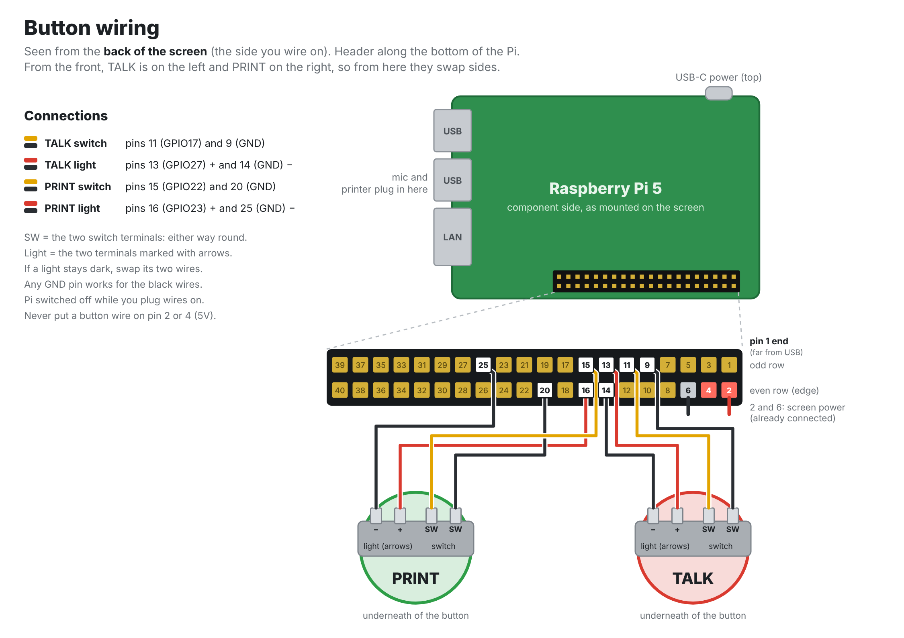

# Voice Labels

A stand-alone voice-to-label printer. Hold the button, say what the label should say, fix any words on the keyboard, check the preview, and print a 2×3" label. Speech recognition runs entirely on the Pi, so there are no fees and no internet needed after setup. The only thing that goes online is searching for a new icon.

```
 hold button → speak → release → text appears → edit → preview updates → PRINT
```

## What's on a label

Each label has up to four parts, and the screen preview is the exact image that gets printed:

- **Text**: the spoken words, sized automatically to the largest font that fits.
- **Date** (optional): today's date by default; you can type any date or note in its place.
- **QR code** (optional): encodes the label text, or anything you type in the QR field (a URL, part number, etc.).
- **Icon** (optional): a black-and-white picture beside, above or below the text. The text moves out of its way.

Labels can be **landscape** (3" wide, the default) or **portrait** (2" wide). Tap **Rotate** or press F4 to switch. Tap **Align** to line the text up left, center or right.

## Parts

| Part | Notes |
|---|---|
| Raspberry Pi 5, 4GB | 2GB may work but leaves little headroom for the speech model |
| Official 27W USB-C power supply, Active Cooler | |
| 32GB microSD card | |
| Hosyond 7" DSI touchscreen, 800×480 | Ribbon cable to the DSI port, power from the GPIO header (see Display setup). The app also works on the official 5" Touch Display 2 |
| Compact USB or Bluetooth keyboard | Function keys F1–F5 are handy but optional |
| C G CHANGEEK CGS-M1 gooseneck USB microphone | Works with no driver. Bend the gooseneck toward the speaker (see Microphone setup) |
| Two 30 mm arcade buttons with LEDs (TALK and PRINT) | EG Starts 5V type. The case deck has 30.4 mm holes |
| 3D-printed case | See `case/README.md` |
| Zebra GK420d or GC420d, USB | Used; must be the "d" (direct thermal) model or set up for direct thermal |
| 2"×3" direct-thermal die-cut labels | 1" core fits these printers |

## Wiring the buttons

Use the Pi's 40-pin header (physical pin numbers). TALK is the left button on the case deck, PRINT the right.



The diagram is drawn from the back of the screen with the Pi's header along the bottom, so TALK appears on the right. Pin 1 is the end of the header farthest from the USB ports. On each button, the light is the pair of terminals marked with arrows; the other pair is the switch, which can go either way round.

| Wire | Pi pin |
|---|---|
| TALK switch, one leg | Pin 11 (GPIO17) |
| TALK switch, other leg | Pin 9 (GND) |
| TALK light + | Pin 13 (GPIO27) |
| TALK light − | Pin 14 (GND) |
| PRINT switch, one leg | Pin 15 (GPIO22) |
| PRINT switch, other leg | Pin 20 (GND) |
| PRINT light + | Pin 16 (GPIO23) |
| PRINT light − | Pin 25 (GND) |

No resistor is needed on the switches; the Pi's internal pull-ups are used. The EG Starts buttons have a resistor built into the light, which glows a little dimmer from the Pi's 3.3 V pins than at 5 V. If a light doesn't come on at all, set its `_LED_PIN` to `None` in `config.py`. The display's power leads also go on the header (5V and GND); the pins above stay free.

## Display setup (Hosyond 7" DSI)

1. With the Pi off, connect the ribbon cable to the display and to one of the Pi 5's two small camera/display connectors. The Pi 5 needs the narrow 22-pin end; check that the box includes a 22-pin-to-15-pin cable.
2. Connect the display's power leads to a 5V pin (pin 2 or 4) and a GND pin (pin 6). This leaves the button pins (9, 11, 13, 14) free.
3. Boot. On a fresh Raspberry Pi OS the screen should come up by itself. If it stays black with the backlight on, add this line to the end of `/boot/firmware/config.txt` and reboot:
   ```
   dtoverlay=vc4-kms-dsi-7inch
   ```
   If you used the second connector, add `,dsi0` to the end of that line.

The screen is landscape (800×480). The app detects this and puts the text box on the left and the label preview on the right. On a tall screen it stacks them instead.

## Microphone setup (gooseneck USB mic)

The mic works out of the box on the Pi. Distance matters more than anything else for accuracy: quiet or distant audio is the main cause of wrong words.

- **Placement:** in the printed case, the mic plugs straight into the Pi through the opening in the right side wall. Bend the gooseneck toward where people stand, within about 30 cm (1 ft) of their mouth.
- **Mute button:** the mic has its own mute. If every recording comes back as "Didn't catch that," check that it isn't muted.
- **Noise:** the mic picks up sound from all sides, so keep it away from fans. The printer only runs after recording, so it won't interfere.
- **Gain:** open a terminal, run `alsamixer`, press F6 to choose the USB mic, press F4 for capture controls, and raise the Mic level to about 80–90%. Run `sudo alsactl store` to keep the setting after reboots.
- **Check it:** run `.venv/bin/python stt.py` and speak a few test labels at normal volume from where users will stand. If words are often wrong, move the mic closer before changing anything else.

## Setting up the printer

1. Load the 2×3" label roll and adjust the guides to the 2" width. For a 4" printer, center the roll.
2. **Calibrate**: with the printer on, hold the feed button until the status light flashes twice, then let go. The printer feeds a few labels and learns where the gaps are. Do this again whenever you change label sizes.
3. Plug the printer into the Pi by USB. It shows up as `/dev/usb/lp0`, and the app writes to it directly, with no driver needed.

If you would rather use CUPS (for example, to also print from other computers), create a raw queue and put its name in `CUPS_QUEUE` in `config.py`.

## Installing the software

1. Flash **Raspberry Pi OS (64-bit, with desktop)** with Raspberry Pi Imager. Set the Wi-Fi network, username and SSH in the Imager settings.
2. Connect the display as described in Display setup.
3. Copy the `labelbox` folder to the Pi, for example to `/home/<you>/labelbox`.
4. Run the installer while the Pi is online. It installs packages, downloads the speech model (one time), gives your user access to the printer and GPIO, and sets the Pi to boot straight into the app (kiosk mode, below):
   ```
   cd ~/labelbox
   bash install.sh
   sudo reboot
   ```

After the reboot, the app opens fullscreen.

### On-screen keyboard

Raspberry Pi OS shows an on-screen keyboard (squeekboard) when you touch a text field, which covers the app. The installer turns it off for your user (`kiosk/launchers.sh` adds `~/.config/autostart/squeekboard.desktop`); delete that file to bring it back. To turn it off for the whole system, including the login screen, run `sudo raspi-config nonint do_squeekboard S3`.

### Kiosk mode

The Pi boots straight into Voice Labels with no desktop behind it. If the app crashes or closes, it restarts within a couple of seconds.

- **To get to the desktop:** open **⚙ Setup**, tap **Power**, then tap **Desktop** twice, or press **Ctrl+Shift+Q**.
- **To go back to the app:** tap the **Voice Labels button in the taskbar**, or double-click the **Voice Labels** icon on the desktop (it's also in the menu), or reboot. These buttons work without kiosk mode too; to add them on their own, run `bash kiosk/launchers.sh` (no sudo).
- **To turn kiosk mode off** (boot to the desktop and start the app there instead): `sudo bash kiosk/uninstall-kiosk.sh`. To turn it back on: `sudo bash kiosk/install-kiosk.sh`.

Logs: `journalctl -u labelbox -f`.

### Boot logo

From power-on, the screen shows the Voice Labels logo instead of the Raspberry Pi splash, with no boot text, and the logo stays up until the app appears. `install-kiosk.sh` sets this up. To set it up on its own: `sudo bash kiosk/install-splash.sh`, then reboot. To get the Raspberry Pi splash back: `sudo plymouth-set-default-theme -R pix`.

`kiosk/launchers.sh` also makes the logo the desktop wallpaper.

### Power-off protection (safe to unplug)

Normally a Pi should be shut down before its power is cut, or the SD card can be damaged. Protection removes that risk: the SD card's main partition becomes read-only and every change is kept in memory instead, so you can unplug it at any moment. Your settings (brightness, print hold, alignment, icon placement) and saved icons are kept on the boot partition, so they still survive restarts.

```
sudo bash kiosk/protect.sh on       # then: sudo reboot
sudo bash kiosk/protect.sh off      # then: sudo reboot
bash kiosk/protect.sh status
```

The top of the Setup screen shows whether it's safe to unplug.

While protection is on, anything else you change is lost at the next restart: app updates, installed packages, files in your home folder. To update, turn protection off, restart, make the changes, then turn it back on. Set up everything else (kiosk mode, the boot logo) before turning protection on.

## Using it

| Main screen | Setup screen |
|---|---|
|  |  |

The main screen has **Hold to talk** (top left) and **PRINT** (top right). Under them, the dark **text box** on the left is where you edit the words, and the **label preview** on the right shows the label exactly as it will print, drawn on its backing paper. The status message sits under the text box, and **Rotate**, **Align**, **Icon**, **Help** and **Setup** sit under the preview. **Help** lists the voice commands and touch shortcuts. Every button has an icon beside its label.

| Do this | To |
|---|---|
| **Hold** the TALK button (or **Hold to talk** on screen), speak, release | Record. The words appear without a closing period, since labels don't need one. The TALK light stays on while it listens and works out the words, then blinks twice when the text is in (it also blinks twice when the app is ready at startup). F1 starts and stops recording from the keyboard |
| **Tap** TALK, then straight away **press and hold** it again (screen or deck button), speak, release | Clear the text and start over. The status says "Cleared. Listening…" |
| Type in the text box | Fix any words. The preview updates as you type |
| **Hold** the PRINT button (on screen or on the deck) for 3 seconds | Print. A green bar sweeps across PRINT and counts down; let go early to cancel. The PRINT light blinks while you hold, stays on while printing, then blinks twice when done. Ctrl+P or Ctrl+Enter print straight away |
| Press the deck's **PRINT** button while the Setup, icon or icon placement screen is open | Acts as **Done / OK**: closes that screen and goes back to the main screen (it doesn't print). On the icon screen, if you've typed a new word it runs the search first. If the screen was dark, the first press only wakes it |
| Tap **⟳ Rotate**, or press F4 | Switch landscape / portrait |
| Tap **Align**, or press F5 | Line the text up left, then center, then right. The button shows the current choice, and it's remembered across restarts (also on the Setup screen) |
| Tap **Icon**, or press F6 | Add an icon (see Icons below). With an icon already on the label, it opens the icon placement screen |
| Press Esc | Clear the text and remove the icon (to remove just the icon, tap **Icon**, then **No icon**) |
| **Double-tap** the text box or the label preview | Clear the text and the icon |
| Tap **⚙ Setup** | Open the Setup screen (below) |
| **Press and hold** on the text box or the label preview for 1.5 seconds | Turn the screen off now, like the screen saver. Tap to wake it |

**Setup screen.** Tap **Done** or press Esc to return.

| Setting | What it does |
|---|---|
| **Date** (green with ✓ when on) and its text field | Print the date, or any text you type there. F2 also toggles it. On or off is remembered across restarts |
| **QR** (green with ✓ when on) and its text field | Print a QR code of the field's text, or of the label text if the field is blank. F3 also toggles it. On or off and the QR text are remembered across restarts |
| **Align Left / Center / Right** | Line the label text (and the date) up on the left, center or right. F5 cycles through them. Remembered across restarts |
| **Copies − / +** | How many labels each PRINT makes |
| **Brightness 25 / 50 / 75 / 100%** | Screen brightness. Remembered across restarts |
| **Print hold Off / 1 / 2 / 3 / 5 s** | How long PRINT must be held. Off prints on a tap. Remembered across restarts |
| **Power** | Opens three tiles: **Restart**, **Shut down**, and **Desktop** (leave the app for the Raspberry Pi desktop). Tap a tile once and it turns red; tap it again to go ahead. Kiosk mode sets up the permission for Restart and Shut down; without kiosk mode, run `sudo bash kiosk/allow-power.sh` once |
| **Network** | Choose how the Pi gets its IP address (see below) |
| Under the title | The Pi's name and current IP address, for connecting to it over the network, and whether it's safe to just unplug it |

**Network screen.** Tap **Network** on the Setup screen.

<p align="center"></p>

- **Automatic** (the default): the router hands the Pi an address each time it connects (DHCP). It can change after a restart; the Setup screen always shows the current one.
- **Fixed address**: type the IP address, the router's address and a DNS server (usually the router again) with the number pad or a keyboard, then tap **Save**. The Pi uses that address every time it starts. Pick one your router doesn't hand out to other devices (outside its DHCP range), or reserve it in the router's settings.

The fields start filled in with the current address, router and DNS, so for a fixed address you often only need to change the last number. **Save** checks the numbers first (and that nothing else on the network already uses the address), applies them to the Wi-Fi or Ethernet connection in use, and waits for the Pi to reach the router. The connection drops for a few seconds while it does. If the Pi can't reach the router with the new settings, the old ones are put back, so a typo can't cut it off the network. The choice is saved with the other settings and put back at every start, so it holds with power-off protection on too.

Changing the network needs the same permission as Restart and Shut down: kiosk mode sets it up; otherwise run `sudo bash kiosk/allow-power.sh` once (run it again if you set it up before the Network screen existed).

**Staying connected.** The app turns Wi-Fi power saving off (the Pi's Wi-Fi chip can stop answering while it naps) and checks the router every 20 seconds. If the router stops answering for about a minute, it reconnects the Wi-Fi, then turns the radio off and on if that doesn't help. Each drop and recovery is written to `network.log`, with the signal strength at the time.

The screen goes dark after 5 minutes with no touch, key or button press. Tap it to wake it; that first tap only wakes the screen and never presses a button. Pressing TALK while the screen is dark wakes it and starts recording; PRINT wakes it and starts the hold. The screen comes back at the brightness you chose.

### Icons

Tap **Icon** to put a black-and-white picture on the label. Icons come from [Iconify](https://iconify.design), a free collection of open-source icon sets, so finding a new one needs internet; icons you've used are saved on the Pi and work offline.

1. **Find one.** The icon screen opens on your saved icons. To find a new one, hold TALK and say a word ("coffee", "screws", "fire extinguisher"), or type it and tap **Find**. Results come in pages of 21; use **Prev** / **Next**.
2. **Tap an icon.** It goes on the label and into your saved icons, and the placement screen opens.
3. **Place it.** The label is shown large with a button on each side: **Top**, **Bottom**, **Left**, **Right**. Pick a side and an **Icon size** (Small, Medium, Large); the text shrinks and moves to make room. Tap **Done**.

On the placement screen, **Change** picks a different icon and **Remove** takes it off the label. On the icon screen, **Remove saved** lets you tap saved icons to delete them. The side and size you pick are remembered for the next icon.

With only an icon and no text, the icon is centered and fills the label.

The search covers about twenty open-source icon sets chosen for single-colour, print-friendly icons, including plenty of computer and maker parts: USB, HDMI, Ethernet and power cables, network and graphics cards, RAM, CPUs, SSDs, NVMe, power supplies, motherboards, filament spools, 3D printers, screws and more. Common words are matched to what the icon sets call things, so saying "video card" also finds "graphics card" and "GPU", and "PLA" or "filament" finds spools. Thin, two-tone and crossed-out ("off") variants are left out because they print poorly. To add your own words, use `ICON_SYNONYMS` in `config.py`; the sets themselves are in `ICON_SETS`.

### Voice commands

Say these while holding TALK. The **Help** button under the preview lists them on screen.

| Say | What it does |
|---|---|
| "space" | Adds a space. Use it between spelled words: "T R A E space J O H N S O N" gives Trae Johnson |
| "start over" | Clears all the text. Anything said after it in the same recording is kept |
| "upper case" | Makes everything UPPER CASE |
| "lower case" | Makes everything lower case |
| "title case" | Capitalizes Each Word |
| "undo" | Goes back to how the label was before the last change: a recording, a voice command, a double-tap clear, Esc, or choosing or removing an icon. Say it again to step back further |
| "remove ..." | Takes something out of the whole text. Punctuation by name: "remove comma", "remove dash", "remove period", "remove question mark", "remove commas and periods", "remove punctuation" (all of it). Anything else is removed as words: "remove Johnson" |

The case commands change the whole label. Said on their own, they change the text already in the box instead of replacing it; said after some words ("blue cable upper case"), they apply to the new text. "Space", "undo" and "remove" are always taken as commands, so a label that needs those words (REMOVE BEFORE FLIGHT) has to be typed. To turn the commands off, set `VOICE_COMMANDS = False` in `config.py`.

### Spelling words out

To get a name, code or part number exactly right, spell it: hold TALK and say the letters one by one, "T, R, A, E". The app notices a run of single letters and joins them back into one word on the label: **Trae**. You can mix spelling with ordinary words ("T R A E Johnson" gives Trae Johnson). Numbers inside a spelled run are kept with it, in capitals ("R J 45" gives RJ45). The recognizer sometimes writes spelled letters with dashes or periods ("T-R-A-E.", "S. M. I. T. H."); those are joined the same way. Two or three initials with periods are left as initials ("J. R. R. Tolkien").

Ordinary single letters are left alone: "Plan B", "vitamin C", "a", "I". It takes two or more spelled letters in a row (or three or more with letter names like "ess" between them). To get capitals (TRAE) set `SPELL_CASE = "upper"` in `config.py`; to keep the letters apart (T-R-A-E) set `SPELL_JOINER = "-"`; `SPELL_JOINER = None` turns this off.

Tips for accuracy:
- Hold the button a moment *before* you start talking, and release a beat after you finish.
- Keep the mic 15–30cm from your mouth, away from fans and the printer.
- Spell-outs and part numbers are where speech recognition most often slips. A quick look at the preview catches them.

## Configuration

Everything adjustable is in `config.py`, with comments. The most common changes:

| Setting | What it does |
|---|---|
| `ORIENTATION` | Default layout: `"landscape"` or `"portrait"` |
| `LABEL_WIDTH_IN`, `LABEL_LENGTH_IN` | How the labels sit in the printer: width across the print head, and length along the feed. 3 and 2 for a 3 × 2" roll loaded wide side across |
| `LANDSCAPE_ROTATE_DEG` | Change 90 to 270 if labels whose layout is turned to fit the roll (portrait on a wide roll) print upside down |
| `TEXT_ALIGN` | Starting alignment: `"left"`, `"center"` or `"right"` (the Setup screen choice overrides it) |
| `ICON_SETS` | The Iconify icon sets searched for icons (solid, single-colour sets print best) |
| `ICON_SYNONYMS` | Your own search words, e.g. `{"zip ties": ["cable tie"]}` |
| `ICON_POSITION`, `ICON_SIZE` | Where a new icon goes and how big, until you choose on the placement screen |
| `DATE_FORMAT` | `"%b %d, %Y"` = Oct 16, 2026; `"%m/%d/%Y"` = 10/16/2026 |
| `DATE_DEFAULT_ON`, `QR_DEFAULT_ON` | Whether date / QR are on when the app starts |
| `PRINT_DARKNESS` | 0–30. Raise if the print is faint |
| `RECORD_MODE` | `"replace"` the text with each recording, or `"append"` to it |
| `PRINT_HOLD_SECONDS`, `PRINT_HOLD_CHOICES` | Default PRINT hold time, and the choices on the Setup screen (0 = no hold) |
| `TALK_BUTTON_PIN`, `PRINT_BUTTON_PIN`, `*_LED_PIN` | GPIO pins for the two buttons and their lights |
| `MIC_NAME` | Text in the microphone's name. The app finds it on any USB port; `./run.sh stt.py --list` shows the names |
| `SPELL_JOINER` | What goes between spelled-out letters: `""` for Trae, `"-"` for T-R-A-E, `None` to leave them as heard |
| `SPELL_CASE` | Capitals for a joined word: `"name"` (Trae, RJ45), `"upper"` (TRAE) or `"lower"` |
| `VOICE_COMMANDS` | `True` to act on "space", "start over", "upper case", "lower case", "title case", "undo" and "remove"; `False` to keep them as words |
| `KEYTERMS` | Words the speech model should favor (part numbers, names, jargon), spelled as you want them printed |
| `SCREEN_BLANK_SECONDS` | Seconds of inactivity before the screen goes dark (0 = never) |
| `LONG_PRESS_BLANK_SECONDS` | How long to hold on the text box or preview to turn the screen off (0 = never) |
| `DOUBLE_TAP_SECONDS` | How soon after a tap on TALK a press and hold counts as "clear and start over" |
| `BRIGHTNESS_LEVELS` | The brightness choices on the Setup screen, in percent |

## Testing without the hardware

On any Linux or Mac computer with Python 3 and Tk:

```
python3 -m venv .venv && .venv/bin/pip install -r requirements.txt
.venv/bin/python app.py --windowed --dry-run
```

The window is 800×480 by default to match the Hosyond screen. Add `--size 720x1280` to see the tall layout.

`--dry-run` saves each label to `out/` as a `.zpl` file and a `.png` of the preview instead of printing. To test only the microphone and speech model, run `.venv/bin/python stt.py`.

## Troubleshooting

| Problem | Fix |
|---|---|
| "Printer not found at /dev/usb/lp0" | Check the USB cable and power. Run `ls /dev/usb/` to see the device name and update `PRINTER_DEVICE` |
| "No permission for /dev/usb/lp0" | The installer adds you to the `lp` group; reboot so it takes effect |
| Labels print across two labels, or skip one | Calibrate the printer again (see Setting up the printer) |
| Print is faint | Raise `PRINT_DARKNESS`, or check that the labels are direct-thermal (scratch one with a fingernail; it should leave a dark mark) |
| "Microphone not found" | Plug the mic into any USB port and press TALK again; the app looks for it each time. If you use a different mic, set `MIC_NAME` to part of its name (`./run.sh stt.py --list`) |
| App doesn't start at boot | Check the kiosk service: `systemctl status labelbox` and `journalctl -u labelbox -b`. Run `sudo bash kiosk/install-kiosk.sh` again if it's missing |
| Icon search says "No internet connection" | The Pi needs internet only to find new icons. Check Wi-Fi, or pick from your saved icons |
| Saved icons disappear after a restart with protection on | Turn protection off and on again once (`sudo bash kiosk/protect.sh off`, restart, `... on`, restart) so it installs the icon helper |
| A deck button does nothing | Check the wiring against the table above. The status line says "Hold the Talk button (or press F1)" when the app can't see the TALK button |

## Files

| File | Purpose |
|---|---|
| `app.py` | The screen: editor, preview, buttons |
| `render.py` | Draws the label (text fitting, date, QR) |
| `zpl.py` | Converts the label image to Zebra's ZPL language |
| `printer.py` | Sends the ZPL to the printer |
| `stt.py` | Push-to-talk speech recognition with Moonshine |
| `hardware.py` | The deck buttons and their lights |
| `config.py` | All settings |
| `icons.py` | The button icons, drawn with Pillow (run it to see them all on one sheet) |
| `network.py` | Reads and sets the IP address (automatic or fixed) through NetworkManager |
| `spelling.py` | Spots spelled-out words in the recognized text and joins the letters |
| `iconlib.py` | Label icons: online search, download cache and the saved-icon library (`icon-library/`) |
| `svgraster.py` | Draws SVG icons with Pillow and numpy, so no extra graphics library is needed |
| `install.sh` | One-time setup on the Pi |
| `run.sh` | Starts the app (or another script) with the right environment |
| `kiosk/` | Boot-to-app service, boot logo, desktop launchers, and install/uninstall scripts |
| `assets/` | Logo, app icon and boot splash (SVG sources and PNGs) |
